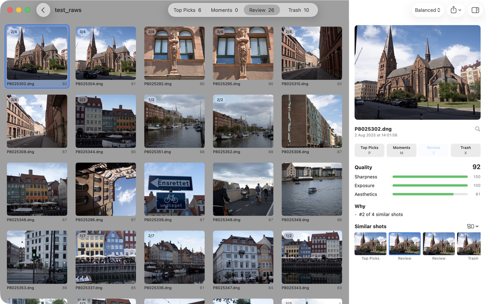
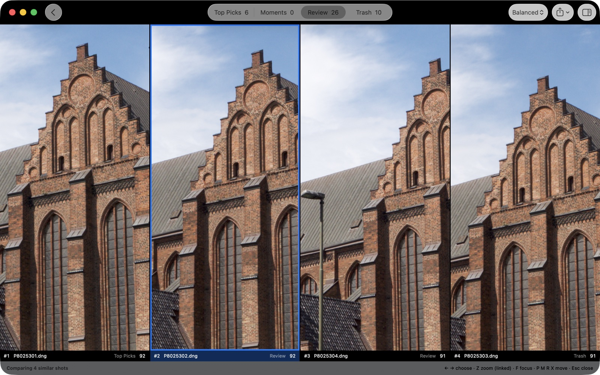

# Keepers

**Find your best shots, automatically.**

Keepers is a native Mac app that ranks every photo in a folder with Apple's on-device Vision framework (sharpness on the subject, exposure, aesthetics, faces, closed eyes, smiles, near-duplicates), then helps you pick the keepers with a few keystrokes.

Built for photographers who come back from a shoot with 400 frames and need to find the 20 worth showing.



- **100% local.** Nothing uploads, nothing downloads. Your photos never leave your Mac.
- **One universal app** for Apple Silicon and Intel, about 3 MB. No Python, no model downloads.
- **RAW-aware**: ORF, NEF, DNG, CR2, CR3, ARW, RW2, RAF, plus JPG/HEIC/PNG/WebP/TIFF/BMP/GIF. RAW+JPEG pairs count as one photo.
- **Bursts collapse.** Ten frames of the same moment yield one pick, a couple of runner-ups to review, and the weaker rest in Trash.
- **Originals are never modified.** Output folders contain symlinks back to your source files.

Requires macOS 13 or later. Aesthetics scoring uses Vision's built-in model on macOS 15+; on 13–14 Keepers scores without it unless the optional model is installed (see [`docs/SCORING.md`](docs/SCORING.md#aesthetics)).

## Install

Download the latest `.dmg` from [Releases](https://github.com/skykery/keepers/releases) and drag Keepers to Applications.

## Quick start

1. Choose (or drop) a folder of photos.
2. Pick how selective to be: *Strict* (top 5%), *Balanced* (top 15%), or *Lenient* (top 25%).
3. Click **Start Culling**. Analysis runs at a few photos per second.
4. Walk through the folders and move photos with one keystroke.

Photos land in four folders inside your source folder:

```
Top Picks/   — the best frame of the strongest moments
Moments/     — the biggest smiles and laughs, even when technically softer
Review/      — everything else, with similar shots grouped and ranked
Trash/       — out of focus, blown out, or black; plus weaker duplicates of a better frame. Never a big smile.
```

Each folder contains symlinks back to the originals. Drag one out (to Lightroom, iCloud, a thumb drive) and macOS gives you the real file, not the shortcut. The links are relative, so they keep working if you move or rename the shoot folder or the drive it's on.

Changing the preset later re-sorts instantly, with no re-analysis. Photos you moved by hand stay where you put them.

## A typical cull

1. **Start with Top Picks.** These are the frames Keepers would show. Select one and press `Return` for the sidebar: the quality score, its three parts, and *why* it landed there ("Best of 4 similar shots", "Sharpest of its group at full resolution").
2. **Check the close calls.** A badge like `2/4` means the photo is one of four similar shots. Press `C` to see the whole group side by side, then `Z` to zoom all of them to 100% on the same spot. Pick the one you like with `←` `→` and press `P`.

   

3. **Skim Review.** Everything that's usable but not a pick. Promote what you like with `P`, send the rest to Trash with `X`. Similar shots stay next to each other, best first.
4. **Glance at Trash.** Each photo says why it's there (out of focus, blown out, or a weaker duplicate of a better frame). Rescue anything with `R` or `P`. `⌘Z` undoes any move.
5. **Hand off.** Write ratings to XMP sidecars for Lightroom or Capture One, export the picks, or drag them straight out of the `Top Picks` folder. When you're sure, move Trash's originals to the Finder Trash.

Keepers learns from your moves: Keepers → Learn From My Choices… shows how often it agrees with you and can tune the scoring to match.

## Working with other apps

- **Lightroom Classic, Capture One, Bridge:** File → Write Ratings to XMP Sidecars writes `IMG_001.xmp` next to each photo: Top Picks ★★★★★ Green, Moments ★★★★ Yellow, Review unrated, Trash rejected (−1) Red. Import the folder and filter by stars or label. Existing sidecars keep their develop settings. Lightroom reads sidecars only for RAW files (not JPEG or DNG, whose metadata it reads from the file itself).
- **Export:** File → Export Top Picks (and Moments) copies the originals, with RAW+JPEG pairs and sidecars, to a folder you choose. Nothing is overwritten; re-exporting skips identical files.
- **Clean up:** File → Move Trash Originals to the Finder Trash, after reviewing Trash. Restorable from the Finder until you empty it.
- **Memory cards:** insert a card and Keepers offers to copy its photos into a new folder (`~/Pictures/<date> <card>` by default), then starts culling.
- **Finder:** right-click a folder → Open With → Keepers, or Quick Actions / Services → Cull with Keepers, or drop a folder on the Dock icon.

## Keyboard shortcuts

| Key            | Action                          |
|----------------|---------------------------------|
| `←` `→` `↑` `↓`| Move around the grid            |
| `Space`        | Full-screen viewer              |
| `Z`            | Zoom to 100% on the eyes or subject (full resolution) |
| `C`            | Compare similar shots side by side, zoom linked |
| `F`            | Show where the photo is sharp   |
| `Return`       | Show / hide the details sidebar |
| `P` or `1`     | Move to **Top Picks**           |
| `R` or `2`     | Move to **Review**              |
| `M` or `3`     | Move to **Moments**             |
| `X` or `Delete`| Move to **Trash**               |
| `U` or `0`     | Back to the automatic folder    |
| `Esc`          | Close the sidebar               |
| `⌘Z` / `⇧⌘Z`   | Undo / redo a move              |
| `⌘O`           | Open another folder             |

## How the scoring works

Short version: clear failures go to Trash; everything else gets a quality score (subject sharpness 35%, exposure 20%, aesthetics 45%). Similar shots are grouped by capture time and visual similarity, and only the best frame of each group can be a Top Pick.

Full details: [`docs/SCORING.md`](docs/SCORING.md).

## Development

Requires Xcode 16+ and [XcodeGen](https://github.com/yonaskolb/XcodeGen) (`brew install xcodegen`).

```bash
xcodegen                                   # generate Keepers.xcodeproj
open Keepers.xcodeproj                     # run the app from Xcode
swift test --package-path KeepersCore      # run the engine tests
```

The engine lives in the `KeepersCore` Swift package; the SwiftUI app in `App/`. To see what the engine decides for a folder without the UI:

```bash
swift run -c release --package-path KeepersCore keepers-eval ~/Pictures/shoot --signals
```

It prints every signal and decision, and, if you've moved photos by hand in the app, how often the engine agrees with you.

Build a signed universal `.app` (requires an Apple Developer ID; use `-` for a local ad-hoc build):

```bash
DEVELOPER_ID=- scripts/build_and_sign.sh
```

Releases: [`docs/RELEASING.md`](docs/RELEASING.md). History: [`CHANGELOG.md`](CHANGELOG.md). Planned features: [`docs/ROADMAP.md`](docs/ROADMAP.md).

## Privacy

- No telemetry. No analytics. No accounts. No network access, unless you turn on Keepers → Check for Updates Automatically (or choose Check for Updates…), which asks GitHub for the latest release and nothing else.
- All analysis runs on your Mac with Apple's Vision and Core Image frameworks.
- Keepers writes only inside the folder you choose (the four output folders and a `.keepers/` cache), plus what you explicitly ask for: XMP sidecars next to your photos, exports and card imports to a folder you pick, and moving Trash's originals to the Finder Trash after a confirmation.

## License

[AGPL-3.0](LICENSE) © 2026 Alin Banuta
